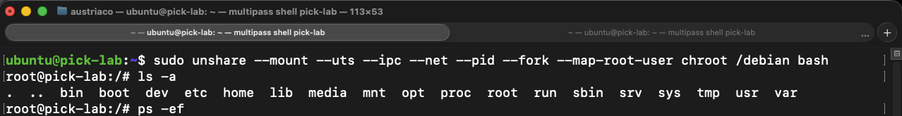
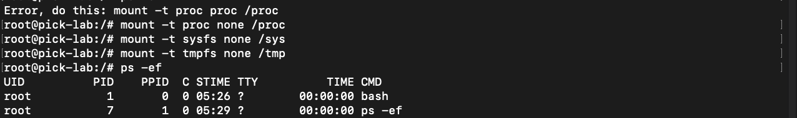
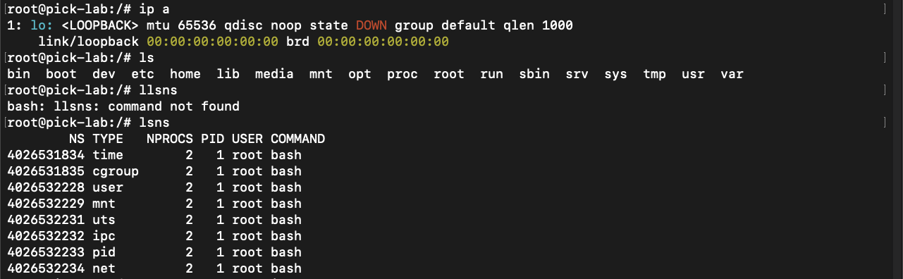
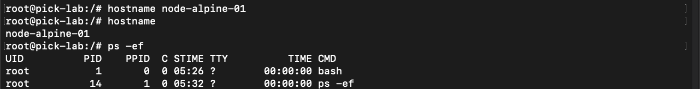
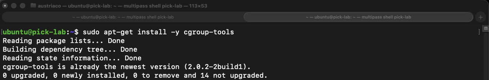
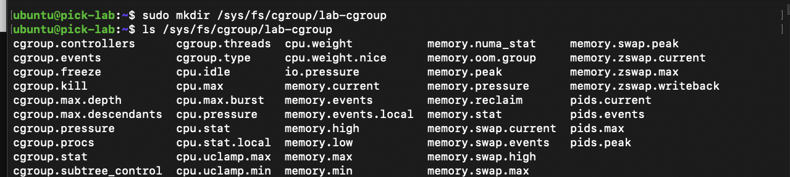
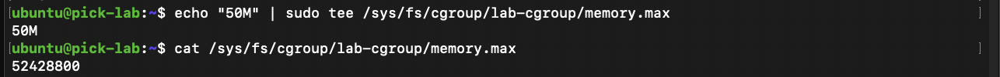
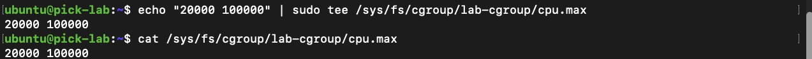
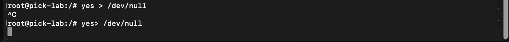

# Containers: Linux Namespaces & Cgroups v2

## Overview
This repository contains a systems engineering laboratory demonstrating how Linux containers operate under the hood without container runtimes such as Docker or containerd. 

The lab focuses on implementing manual process isolation across kernel boundaries using native **Linux Namespaces** (`mount`, `uts`, `ipc`, `net`, `pid`, `user`) coupled with hardware resource throttling via **Control Groups v2 (cgroups-v2)** on Ubuntu 24.04.

---

## Environment Architecture
* **Host Platform:** Ubuntu 24.04 LTS (Kernel Linux 6.8 aarch64) running via Multipass
* **Hardware:** Mac mini M4
* **Root Filesystem (Rootfs):** Dedicated Debian stable filesystem deployed via `debootstrap` to `/debian`
* **Hierarchy Standard:** Native, unified Cgroups v2 architecture mounted on `/sys/fs/cgroup/`

---

## Investigated Scenarios

### Scenario 1: Container Creation and Rootfs Jailing
**Objective:** Decouple process execution boundaries from the host across all primary Linux namespaces and jail execution path to `/debian`.

* **Analysis Step 1: Unshare Execution and Filesystem Verification**
  Executed `unshare` to detach mount, UTS, IPC, network, and PID namespaces while mapping root user permissions and jailing the shell path via `chroot`[cite: 10].
  ```bash
  sudo unshare --mount --uts --ipc --net --pid --fork --map-root-user chroot /debian bash
  ls -a
  ps -ef
  ```
  

* **Analysis Step 2: Pseudo-Filesystems Initialization**
  Mounted the virtual filesystems (`/proc`, `/sys`, and `/tmp`) to enable process inspection within the isolated namespace[cite: 11].
  ```bash
  mount -t proc none /proc
  mount -t sysfs none /sys
  mount -t tmpfs none /tmp
  ps -ef
  ```
  

---

### Scenario 2: Network & Identity Decoupling
**Objective:** Confirm network stack isolation and independently modify UTS hostname namespace.

* **Analysis Step 1: Network Stack and Namespace Inspection**
  Inspected local network devices to confirm that loopback is unconfigured (`DOWN`) and checked namespace allocations using `lsns`[cite: 12].
  ```bash
  ip a
  ls
  lsns
  ```
  

* **Analysis Step 2: Container Hostname Modification**
  Reassigned the internal container hostname to `node-alpine-01` without affecting the host environment[cite: 13].
  ```bash
  hostname node-alpine-01
  hostname
  ps -ef
  ```
  

---

### Scenario 3: Host Auditing and Unified Cgroup Configuration
**Objective:** Map real process hierarchy from the host perspective and prepare unified Cgroup v2 nodes.

* **Analysis Step 1: Global Host PID Resolution**
  Audited the host process table to identify the real global PID corresponding to the containerized bash shell (PID `26904`)[cite: 14].
  ```bash
  ps -ef
  ```
  

* **Analysis Step 2: Cgroup Tooling Host Verification**
  Checked user-space control group tooling and validated Cgroups v2 availability on Ubuntu[cite: 15].
  ```bash
  sudo apt-get install -y cgroup-tools
  ```
  

* **Analysis Step 3: Unified Cgroup Directory Creation**
  Created the custom control group node directly in the Cgroups v2 unified tree at `/sys/fs/cgroup/lab-cgroup`[cite: 16].
  ```bash
  sudo mkdir /sys/fs/cgroup/lab-cgroup
  ls /sys/fs/cgroup/lab-cgroup
  ```
  

---

### Scenario 4: Hardware Resource Limits and CPU Throttling Validation
**Objective:** Bind the container process, define memory and CPU execution ceilings, and validate real-time throttling under load.

* **Analysis Step 1: Process Attachment to Cgroup**
  Attached global container PID `26904` to the control group by writing directly into `cgroup.procs`[cite: 17].
  ```bash
  echo 26904 | sudo tee /sys/fs/cgroup/lab-cgroup/cgroup.procs
  cat /sys/fs/cgroup/lab-cgroup/cgroup.procs
  ```
  

* **Analysis Step 2: Memory Ceiling Configuration**
  Configured a strict memory boundary of 50 Megabytes (`52428800` bytes) via the `memory.max` interface[cite: 18].
  ```bash
  echo "50M" | sudo tee /sys/fs/cgroup/lab-cgroup/memory.max
  cat /sys/fs/cgroup/lab-cgroup/memory.max
  ```
  

* **Analysis Step 3: CPU Quota Configuration**
  Configured a 20% CPU ceiling (quota of 20,000 microseconds per 100,000 microsecond period) using `cpu.max`[cite: 19].
  ```bash
  echo "20000 100000" | sudo tee /sys/fs/cgroup/lab-cgroup/cpu.max
  cat /sys/fs/cgroup/lab-cgroup/cpu.max
  ```
  

* **Analysis Step 4: Compute Stress Generation**
  Spawned an unconstrained loop inside the container targeting `/dev/null` to force full CPU saturation[cite: 20].
  ```bash
  yes > /dev/null
  ```
  

* **Analysis Step 5: Real-Time Throttling Verification**
  Audited real-time CPU consumption via `htop` on the host, proving that the workload was restricted to ~20.5% CPU utilization[cite: 21].
  ```bash
  htop
  ```
  

---

## Skills Verified
* Linux Namespace Isolation (`mount`, `uts`, `ipc`, `net`, `pid`, `user`)
* Root Filesystem Jailing via `chroot` and Pseudo-Filesystem Management (`/proc`, `/sys`, `/tmp`)
* Cgroups v2 Directory Hierarchy & Controller Architecture Management
* Real-Time Resource Throttling and Workload Verification (`memory.max`, `cpu.max`, `htop`)
