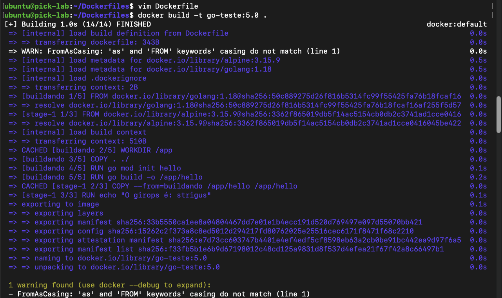
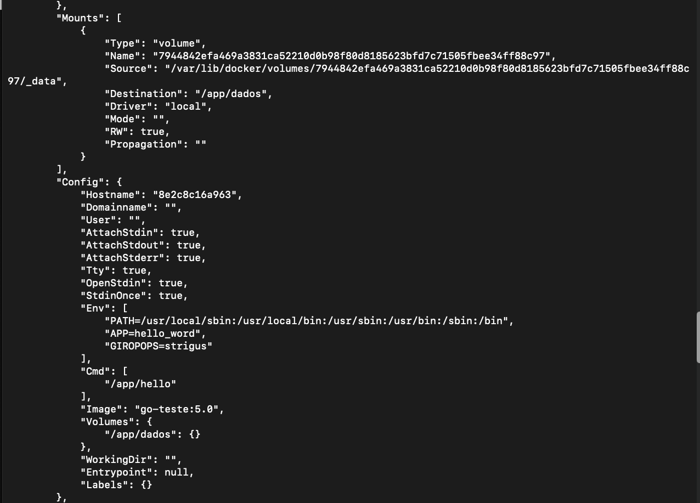
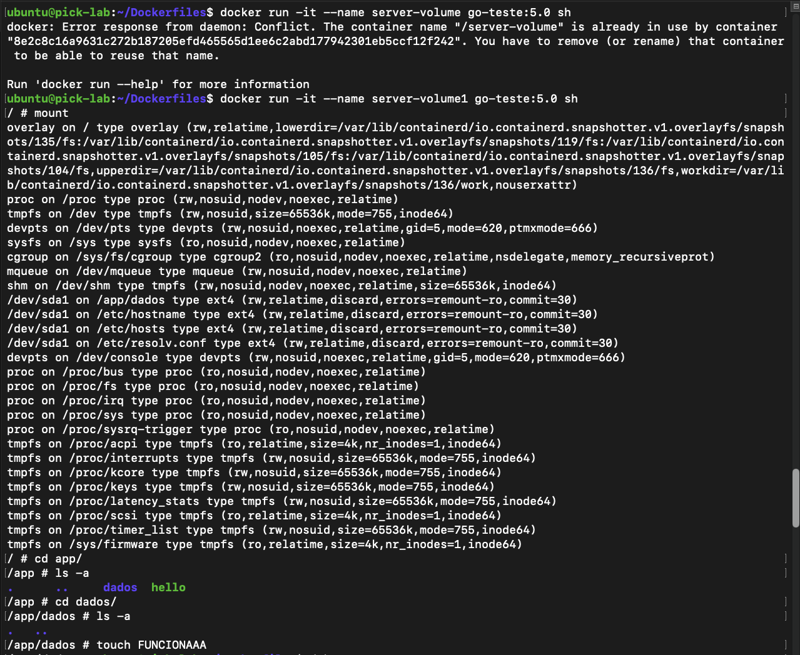
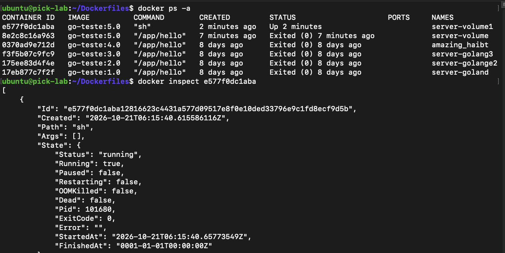
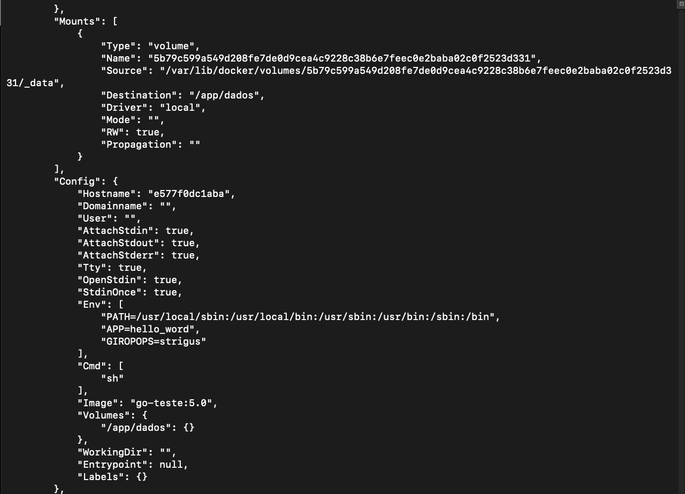
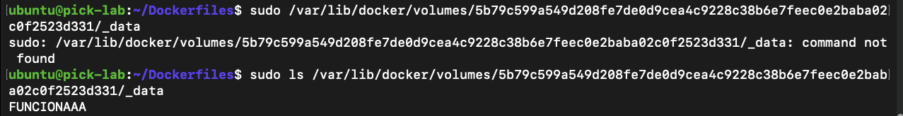

# Lab 03: Docker Volumes, Multi-Stage Builds, and Shell Troubleshooting

## Overview
This laboratory covers the configuration and inspection of anonymous Docker volumes declared via the `VOLUME` instruction inside a multi-stage `Dockerfile`. It demonstrates troubleshooting missing execution shells in minimal base images (Alpine Linux), inspecting internal container metadata with `docker inspect`, and verifying underlying host storage persistence under `/var/lib/docker/volumes/`.

---

## 1. Initial Dockerfile and Shell Failure

### Dockerfile with Missing Shell Issue (`Dockerfile-com-SHELLbugado`)
The initial implementation utilized Alpine Linux 3.15.9 while explicitly overriding the default shell interpreter with `SHELL ["/bin/bash"]`:

```dockerfile
FROM golang:1.18 as buildando
WORKDIR /app
COPY . ./
RUN go mod init hello
RUN go build -o /app/hello

FROM alpine:3.15.9
SHELL ["/bin/bash"]
COPY --from=buildando /app/hello /app/hello
ENV APP="hello_word"
ARG giropops="strigus"
ENV GIROPOPS=$GIROPOPS
RUN echo "O girops é: $GIROPOPS"
VOLUME /app/dados
CMD ["/app/hello"]
```

### Build Execution and Failure
Executing the build command failed during step `[stage-1 3/3]`:

```bash
docker build -t go-teste:5.0 .
```


**Root Cause Analysis:**
Alpine Linux relies on `busybox` and provides `/bin/sh` natively, but does not ship with `/bin/bash` by default. The instruction `SHELL ["/bin/bash"]` caused `runc` to abort container execution:
```text
runc run failed: unable to start container process: error during container init: exec: "/bin/bash": stat /bin/bash: no such file or directory
```

---

## 2. Fixed Dockerfile and Successful Build

### Corrected Dockerfile (`Dockerfile`)
Removing the incompatible `SHELL` instruction restores Alpine's default shell (`/bin/sh`):

```dockerfile
FROM golang:1.18 as buildando
WORKDIR /app
COPY . ./
RUN go mod init hello
RUN go build -o /app/hello

FROM alpine:3.15.9
COPY --from=buildando /app/hello /app/hello
ENV APP="hello_word"
ARG GIROPOPS="strigus"
ENV GIROPOPS=$GIROPOPS
RUN echo "O girops é: $GIROPOPS"
VOLUME /app/dados
CMD ["/app/hello"]
```

### Build Execution
```bash
docker build -t go-teste:5.0 .
```



The image `go-teste:5.0` was built and exported successfully to the local Docker store.

---

## 3. Container Execution and Metadata Inspection

### Initial Container Run
Run a non-daemon container based on `go-teste:5.0`:

```bash
docker run -it --name server-volume go-teste:5.0
```

The compiled binary executed, printed `hello Giropops!`, and exited cleanly with exit status `0`.


### Metadata Inspection (`docker inspect`)
Inspecting the stopped container (`8e2c8c16a963`) displays the anonymous volume binding provisioned by the `VOLUME /app/dados` instruction:

```bash
docker inspect 8e2c8c16a963
```



**Volume Mount Details:**
* **Type:** `volume`
* **Name:** `7944842efa469a3831ca52210d0b98f80d8185623bfd7c71505fbee34ff88c97`
* **Source:** `/var/lib/docker/volumes/7944842efa469a3831ca52210d0b98f80d8185623bfd7c71505fbee34ff88c97/_data`
* **Destination:** `/app/dados`
* **Driver:** `local`
* **Mode:** Read/Write (`RW: true`)

---

## 4. Testing Volume Persistence and Host Storage Verification

### Interactive Session in a New Container
Launch a separate container instance (`server-volume1`), overriding the command to open an interactive shell:

```bash
docker run -it --name server-volume1 go-teste:5.0 sh
```

Inside the container environment:
1. Verify mounted filesystems with `mount`. The destination `/app/dados` is mounted on `/dev/sda1`.
2. Navigate to the volume directory and generate test data:

```sh
cd /app/dados
touch FUNCIONAAA
```



### Verifying Container State and Assigned Host Path
From the host machine terminal, inspect the newly created running container (`e577f0dc1aba`):

```bash
docker ps -a
docker inspect e577f0dc1aba
```




The newly spawned container references its own distinct anonymous volume directory on the host:
`/var/lib/docker/volumes/5b79c599a549d208fe7de0d9cea4c9228c38b6e7feec0e2baba02c0f2523d331/_data`

### Validating Persistence Directly on Host Storage
Inspect the host volume directory with root privileges to confirm the file created inside the container was persisted to disk:

```bash
sudo ls /var/lib/docker/volumes/5b79c599a549d208fe7de0d9cea4c9228c38b6e7feec0e2baba02c0f2523d331/_data
```



Command output:
```text
FUNCIONAAA
```

---

## Technical Takeaways
* **Base Image Binary Constraints:** Minimal distributions like Alpine Linux do not package `/bin/bash` out-of-the-box. Explicit `SHELL` declarations must align with the binaries available in the target runtime (`/bin/sh`).
* **Anonymous Volume Lifecycle:** Declaring `VOLUME <path>` triggers Docker to allocate a new dedicated storage volume under `/var/lib/docker/volumes/<volume-id>/_data` for every container spawned without explicit host-mount parameters (`-v` or `--mount`).
* **Storage Independence:** Data written to declared volume mounts bypasses the container storage driver (overlay2) layer and commits directly to the underlying host filesystem.